<p align="center">
  
</p>

<h1 align="center">CodeCrucible</h1>

<p align="center">
  IDE for agentic development — manage multiple Claude Code sessions in parallel, each in its own git worktree, with built-in diff viewer, PR reviews, and terminal.
</p>

<p align="center">
  <a href="LICENSE">MIT License</a> · <a href="CONTRIBUTING.md">Contributing</a>
</p>

<!-- TODO: Replace with actual screenshot -->
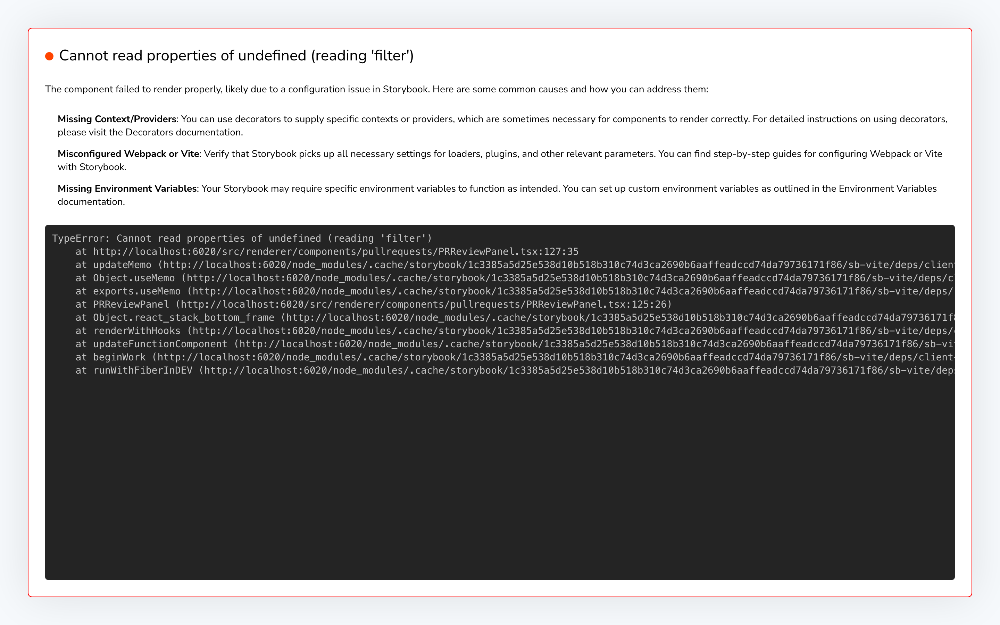

## Features

- **Multi-project management** — Open multiple git repos, switch with draggable tabs, per-project notifications
- **Session isolation** — Each session gets its own git worktree and branch — no conflicts between parallel agents
- **Cloud sessions & Teleport** — New sessions start in Claude Code on the web by default, so heavy builds and CI-style test runs happen off your machine. Watch and talk to the cloud session from the Agent tab, then hit **Teleport** to pull it down into the local worktree and carry on there
- **Embedded terminals** — Full xterm.js shell terminals per session, opened from the workspace tab bar
- **Git integration** — Commit log, changed files, and a GitHub-style syntax-highlighted diff viewer (Shiki) with full-file syntax context, click-anywhere context expansion, per-hunk collapse, and side-by-side or unified modes
- **PR review panel** — Review pull requests without leaving the IDE: conversation, checks, file tree, inline comments, merge
- **Intervention alerts** — Desktop notifications and dock badge when Claude Code needs your input
- **Usage tracking** — Rate limit bars and activity stats per session
- **Code editor** — CodeMirror editor with file explorer for editing files in any worktree
- **Themes** — Dark (Tokyo Night), Light, Soft Light, and Ultra Dark — terminal theme syncs automatically
- **Remote access** — Pair a second device's browser to your desktop instance over the LAN, or over a hosted end-to-end encrypted Cloudflare Worker relay that works through VPNs and hotel Wi-Fi. View projects, sessions, settings, and live agent terminals from anywhere (full mobile layout, PWA-installable on iOS)
- **Custom buttons** — Configurable action buttons that run shell commands or Claude prompts with placement, scope, and shortcut options
- **Session startup prompts** — Pre-configure per-project prompts (e.g. `/notion-ticket {{input}}`) that become the first message of a new session's agent
- **Review loop** — One-click review → triage → fix cycle on a branch. Runs headless in the background by default (`claude -p`, no terminal — the panel streams each transcript), or flip a per-project toggle to run it as three live Claude Code terminals you can watch and steer. Pick a variant per project: **Lite**/**Pro** (three fresh sessions per round) or **Efficient** (fresh stacked reviews + one persistent worker that keeps context across rounds — cheaper). Stop conditions (clean rounds, iteration cap) and a sticky PR comment for skipped findings
- **Visual agents** — Every agent tab is a chat interface to Claude Code rather than a terminal — rich tool cards with diffs, inline permission and question cards, a sub-agent tray, `/btw` side questions in a fork, a model picker, and conversations that resume across app restarts
- **Keyboard navigable** — Full keyboard support: arrow keys, focus trapping, roving tabindex, accessible by default

## Visual Tour

<!-- TODO: Replace with actual screenshots -->

<table>
<tr>
<td width="50%">

**Git diff viewer**

Browse commits and view syntax-highlighted diffs inline.


</td>
<td width="50%">

**PR review**

Review pull requests with conversation, checks, file tree, and inline comments.

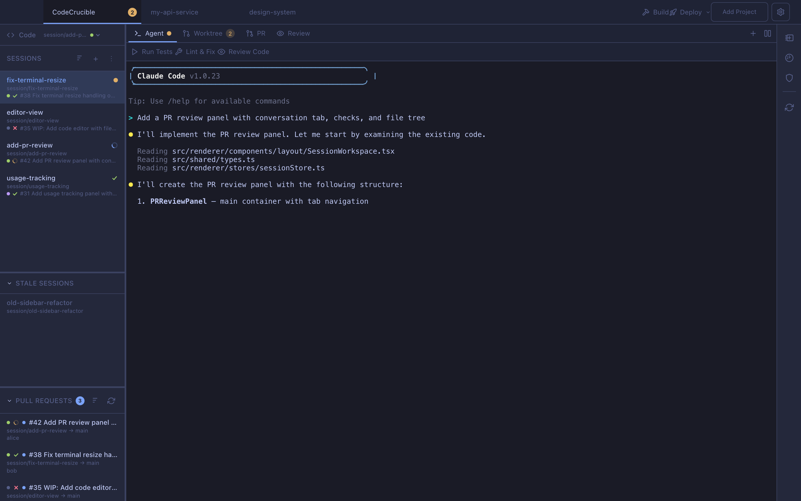

</td>
</tr>
<tr>
<td width="50%">

**Session management**

Sessions show live status: running (spinner), needs attention (dot), or completed (check).

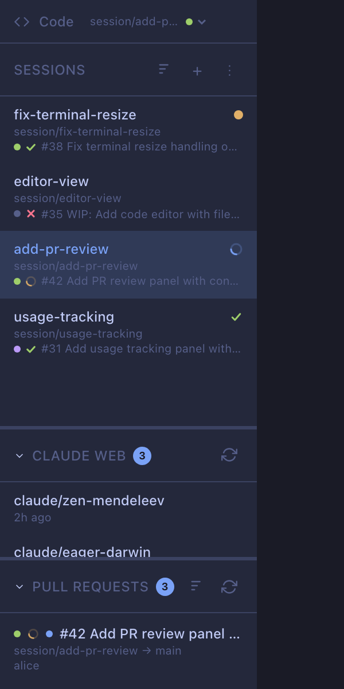

</td>
<td width="50%">

**Code editor**

Built-in CodeMirror editor with file explorer — edit files directly in any worktree.

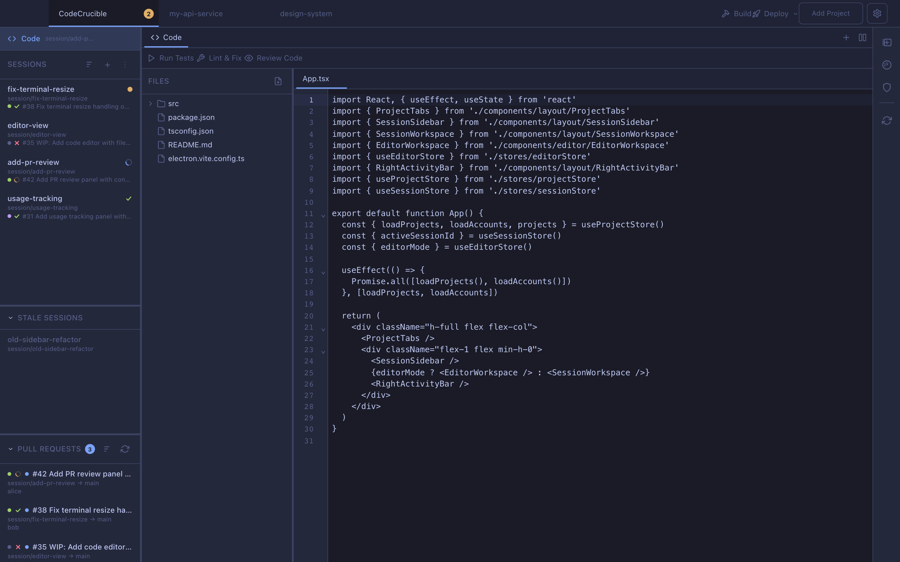

</td>
</tr>
<tr>
<td width="50%">

**Custom buttons**

Add configurable action buttons to the toolbar, top bar, or right sidebar.

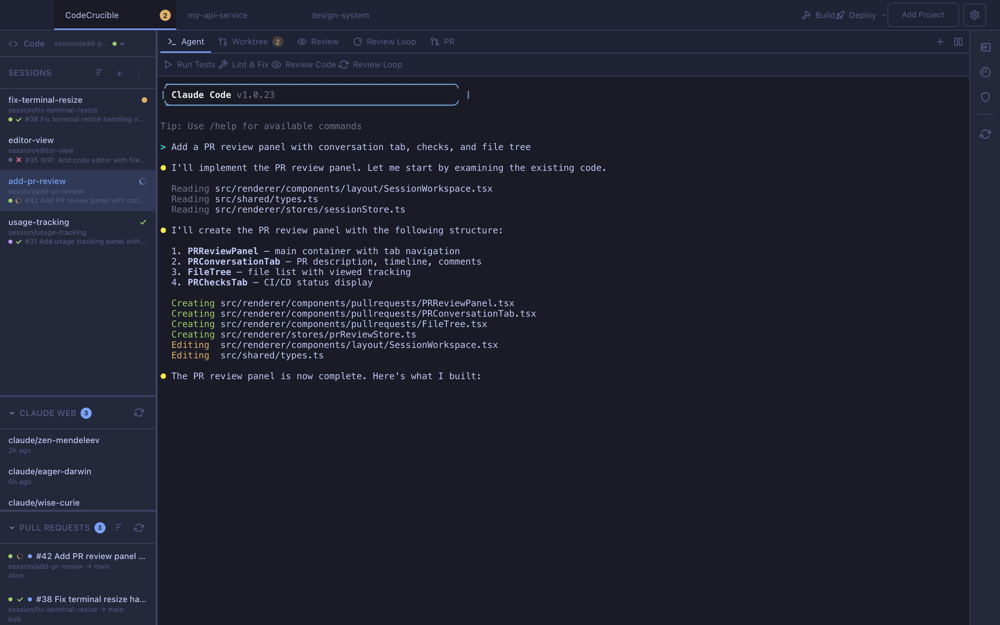

</td>
<td width="50%">

**Button settings**

Full settings UI for creating, editing, and organizing custom buttons.

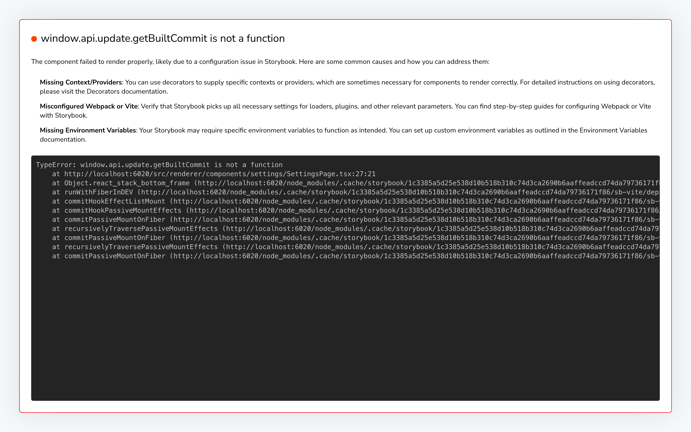

</td>
</tr>
<tr>
<td width="50%">

**Settings & themes**

Four built-in themes with automatic terminal sync, account management, and preferences.


</td>
<td width="50%">

**Themes**

Dark (Tokyo Night), Light, Soft Light, and Ultra Dark.

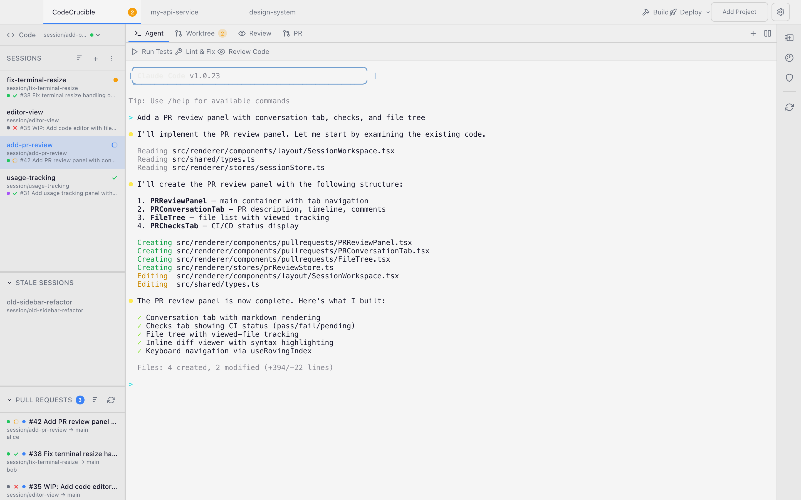

</td>
</tr>
</table>

<details>
<summary><strong>Getting Started</strong></summary>

### Prerequisites

- Node.js 18+, npm
- A git repository to open as a project

### Dev mode

```bash
npm install
npm run dev
```

1. Click **Add Project** and select a folder containing a git repository.
2. Create a session from the sidebar — this creates a new branch and worktree.
3. Tell the session's agent what to work on in its Agent tab, or open a terminal from the **+** menu to run commands in the isolated worktree.
4. View commits and diffs in the git panel as your agent works.
5. Open PRs directly from the git panel toolbar.

### Native install (macOS arm64)

The native install runs from its own bundled assets, so switching branches in the source repo won't break the running app.

```bash
npm run dist
```

This builds and copies `Crucible Code.app` to `/Applications/`.

### Auto-update

The installed app polls `origin/main` every 5 minutes. When new commits land, an **Update Available** button appears in the title bar. Click it to pull, rebuild, and relaunch automatically.

</details>

<details>
<summary><strong>Remote access (web receiver)</strong></summary>

Pair a second device's browser to your desktop in one of two modes. Both serve the same React receiver — same projects, sessions, settings, live agent terminals. Architecture details live in [docs/REMOTE.md](docs/REMOTE.md); the cloud relay deep-dive is in [docs/cloud-relay.md](docs/cloud-relay.md).

| | LAN mode | Cloud mode |
|---|---|---|
| Transport | Embedded WebSocket server on the desktop | Outbound WSS to a hosted Cloudflare Worker relay |
| Requires same network | Yes | No — works through VPN, cellular, hotel Wi-Fi |
| Third party in path | None | Relay (forwards opaque ciphertext only) |
| Encryption | TLS to the LAN listener | TLS + libsodium end-to-end (X25519 + XChaCha20-Poly1305) |
| URL on the phone | `https://<desktop-ip>:<port>` | `https://codecrucible-relay.mattmoran56.workers.dev` |

### LAN mode

Flip the LAN toggle in the desktop top-bar popover. The phone loads the receiver from the desktop and pairs with a 6-char code (single-use, 5-minute TTL); the browser swaps it for a long-lived token stored in `localStorage`.

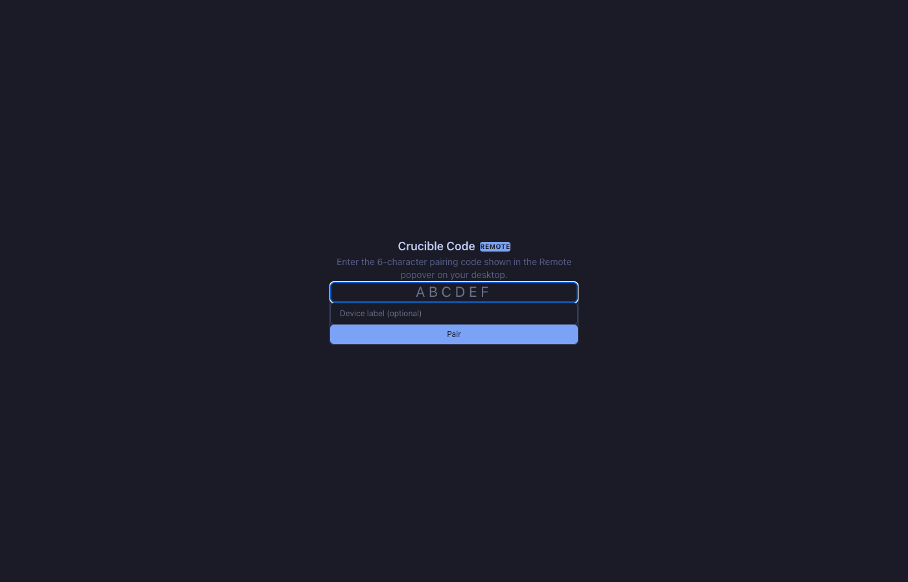
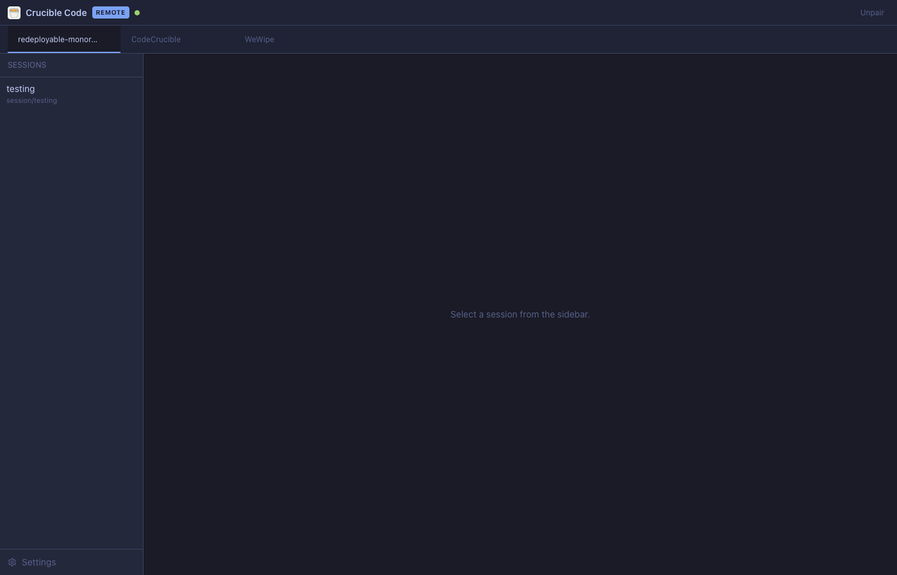
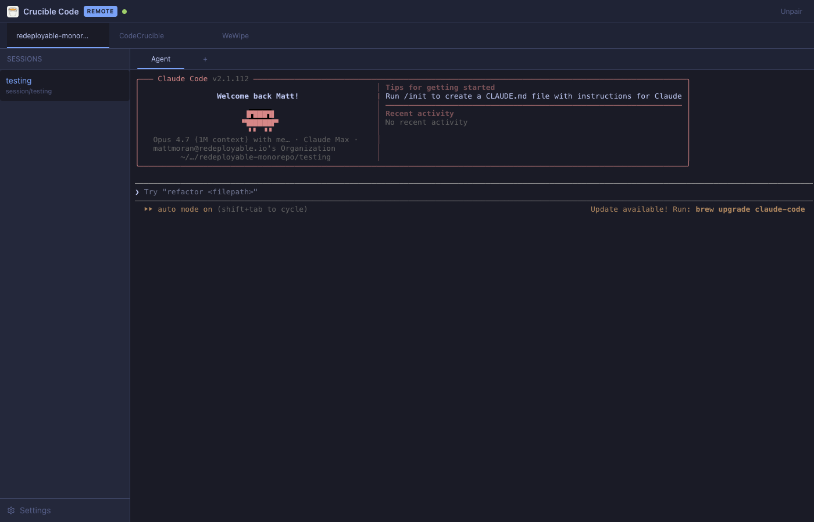
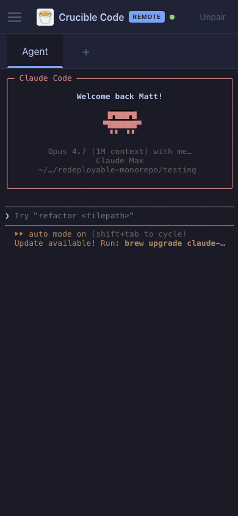
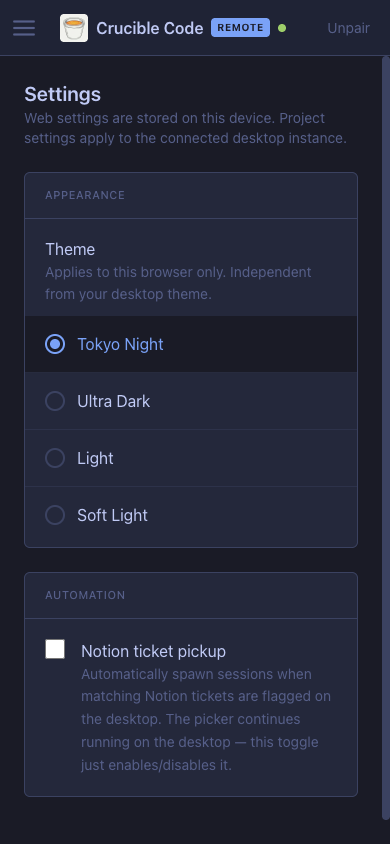

### Cloud mode

Flip **Cloud relay** on in the same popover. The desktop opens an outbound WSS to the hosted relay and registers a handle (e.g. `silver-otter-79`). On the phone, open `https://codecrucible-relay.mattmoran56.workers.dev`, type the handle and 6-char pairing code shown in the popover, and you're paired. On iOS you can install the page via Safari → Share → **Add to Home Screen** to get a standalone PWA with manifest, service worker, notch padding, and sticky tabs.

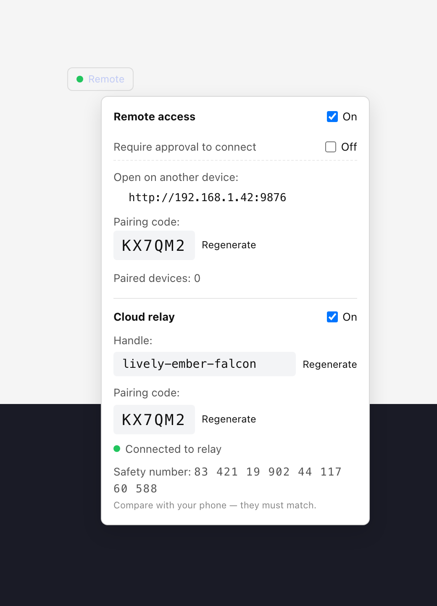
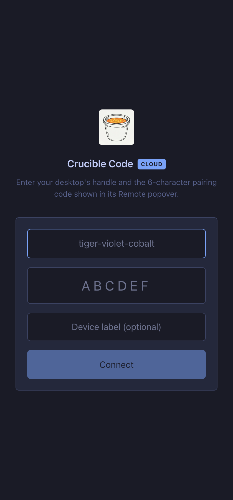

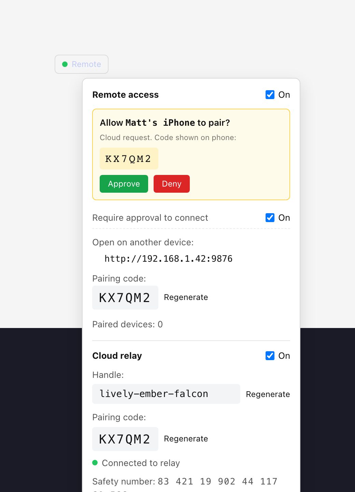

### Security model

End-to-end encrypted in both modes. Cloud mode adds a libsodium handshake on top of TLS: ephemeral X25519 key exchange, HKDF salted with the pairing code (first pair) or bearer token (reconnect), then XChaCha20-Poly1305 on every frame. A 6-digit **safety number** derived from the shared key is displayed on both ends so the user can visually confirm there's no MITM. The relay forwards opaque ciphertext only — it never sees the pairing code, IPC payloads, or terminal output. An optional **approval gate** on the desktop requires the user to Approve or Deny each incoming pairing attempt, closing brute-force of the derived ticket as an attack class. The relay layer adds KV-gated handles (no enumeration), per-IP rate limits on `/register` and `/phone`, and 30-day TTL cleanup of idle handles. Full threat model in [docs/cloud-relay.md](docs/cloud-relay.md).

### Implementation notes

- **Same code paths as the desktop renderer** — `req` frames hit the shared `handlerMap` that `ipcMain.handle` registers, so the relay can never drift from the local UI for the channels it forwards.
- **Live terminal attach with backfill** — Receiver attaches to the *existing* PTY for `(sessionId, tabId)`; the desktop's `terminal.service` keeps a 64 KiB tail per terminal so a remote join shows recent context, then streams new output live. Typing on either device drives the same shell.
- **Mobile layout** — Below 768 px the project tabs collapse into a slide-in drawer, the workspace tab strip grows to thumb-friendly h-14 with full-width accent bar, and the theme picker moves into Settings as a chunky radio list (web-only, independent from the desktop).
- **Out of v1 scope** — Pull requests, env-var sync, and repo cloning to the remote machine.

### Self-hosting the relay

The Worker source is in [`relay-worker/`](relay-worker/README.md) — `npx wrangler deploy` puts it on your own Cloudflare account. Point the desktop at it by setting `RELAY_BACKEND_URL=https://your-relay.example.workers.dev` before launching the app.

</details>

<details>
<summary><strong>Multi-project management</strong></summary>

Open multiple git repositories as projects. Each project gets its own tab in the top bar.

- **Draggable tabs** — Reorder projects by dragging
- **Per-project state** — Active session, PR selection, and workspace layout persist when switching between projects
- **Per-project accounts** — Assign different Claude accounts to different projects for isolated billing and auth
- **Notification badges** — Tab badges show how many sessions need attention across all projects
- **Confirm close** — Closing a project tab prompts for confirmation to prevent accidental removal

</details>

<details>
<summary><strong>Sessions & worktrees</strong></summary>

Each session creates a git worktree at `<repo-parent>/.codecrucible-worktrees/<repo>/<session>/` with its own branch (`session/<name>`).

- **Create from scratch** — New branch from any base branch
- **Cmd+N shortcut** — Opens the New Session dialog from anywhere in the app
- **Cloud or local** — The New Session dialog has a **Cloud / Local** toggle. Cloud (the default, configurable per project) runs the agent in Claude Code on the web; Local runs it in the worktree (see **Cloud sessions & Teleport** below)
- **Agent tab** — Every session opens on its Agent tab: a visual agent (see **Visual agents** below) running in the worktree, or for a cloud session, a terminal attached to the cloud session with a **Teleport** button
- **Cloud badge** — Sessions running in the cloud show a small **Cloud** badge on their sidebar card
- **Import existing worktree** — Bring in worktrees created outside CodeCrucible
- **Open remote branch** — Create a session from a remote branch with autocomplete
- **Open as main branch** — Temporarily check out a session's branch on the main repo (useful for builds that need the real repo path)
- **Rename a session** — Give a session a more identifiable name from the card's `⋯` menu; the underlying git branch is renamed to match

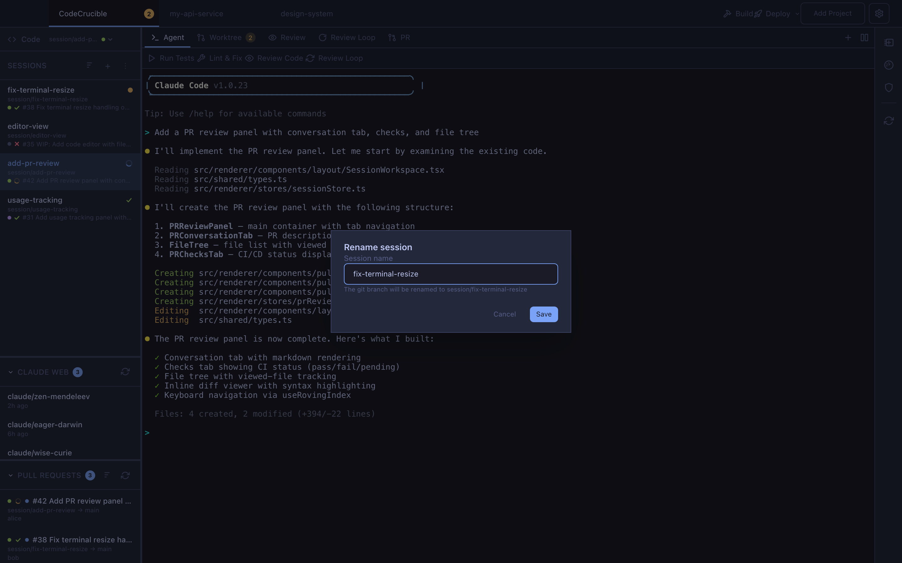

</details>

<details>
<summary><strong>Cloud sessions & Teleport</strong></summary>

Run a session's agent in [Claude Code on the web](https://claude.ai/code) instead of on your machine, watch it from the app, and bring it down locally when you want to test.

- **Cloud by default** — New sessions start in the cloud unless the project's **Settings → Project Defaults → Default session location** is set to **Local**. The New Session dialog's **Cloud / Local** toggle starts from that default; Local behaves exactly as before
- **Starting one** — The worktree and `session/<name>` branch are created as usual, the branch is pushed to GitHub (`git push -u origin <branch>`, so the cloud VM clones it rather than the default branch), and the cloud session is started from the worktree with `claude -p "<task>" --cloud`. A cloud session needs a task: the chosen startup prompt, or what you type in the dialog's **Task** box. If it fails to start, the error is shown and the worktree is removed
- **Watching it** — The Agent tab shows a terminal attached to the session (`claude --cloud <id>`), so you can watch it work and send messages. The toolbar shows a **Cloud** badge, the session id and **Open in browser**. If attaching isn't enabled for your account, the tab says so, offers **Open in browser**, and gives you a box to send follow-ups (`claude -p "<message>" --cloud <id>`)
- **Teleport** — The **Teleport** button asks to confirm, checks the worktree has no uncommitted changes (if it does it lists them and stops; nothing is stashed for you), then runs `claude --teleport <id>` in the same tab, so you watch the session's branch and conversation come down. From there it is an ordinary local Claude session in the worktree, and the session's **Cloud** badge goes away
- **After a restart** — A teleported session's Agent tab opens as a normal visual agent that resumes the teleported conversation. The app finds that conversation's local transcript under your Claude config's `projects/` directory; if it can't, you get a fresh agent and a notice. The conversation continues, but the visual agent only shows messages from after the teleport
- **Requirements** — Signed in to claude.ai in the Claude Code CLI (for the project's Claude account), and the repo on GitHub with the Claude GitHub App installed
- **Scheduled sessions** — Scheduled and Notion-started sessions still run locally
- **Permissions** — No `--permission-mode` or bypass flag is passed to any of these commands; they run in your default (auto) mode

</details>

<details>
<summary><strong>Session startup prompts</strong></summary>

Configure per-project prompts that can optionally auto-run in a new session's agent. Pick one when creating a session — it becomes the Agent tab's first message.

- **Per-project list** — Each project gets its own set of prompts, configured in Settings → Session Startup Prompts
- **Slash commands or freeform** — Use Claude slash commands (`/notion-ticket`, `/run-tests`) or any freeform prompt
- **Optional input** — Use `{{input}}` in the command to ask the user for a value (e.g. a ticket URL) when creating the session
- **None by default** — Picking nothing keeps the existing behavior; the dialog only shows the picker when prompts are configured for the project

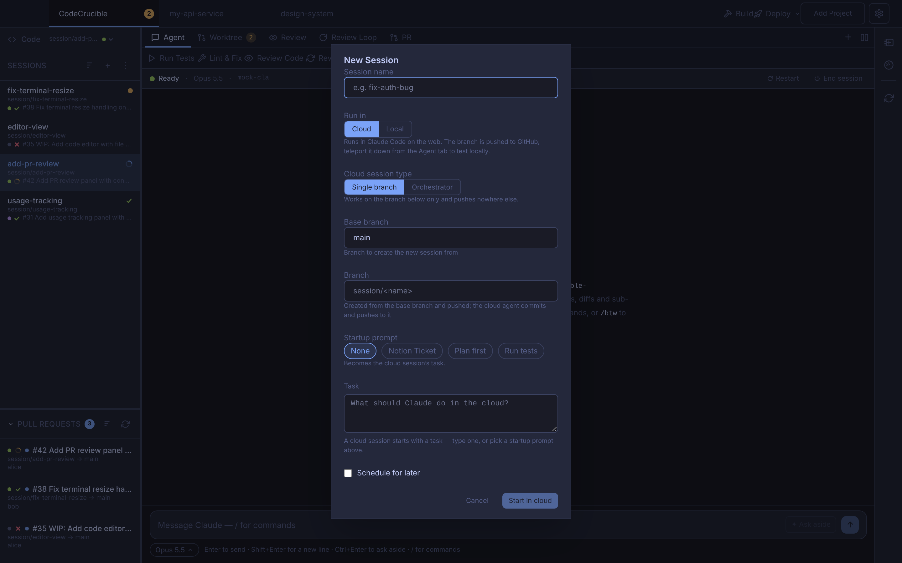
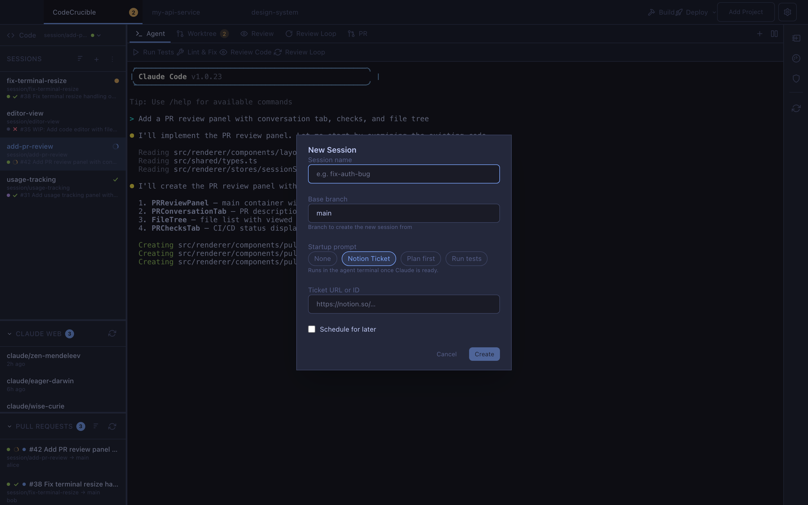
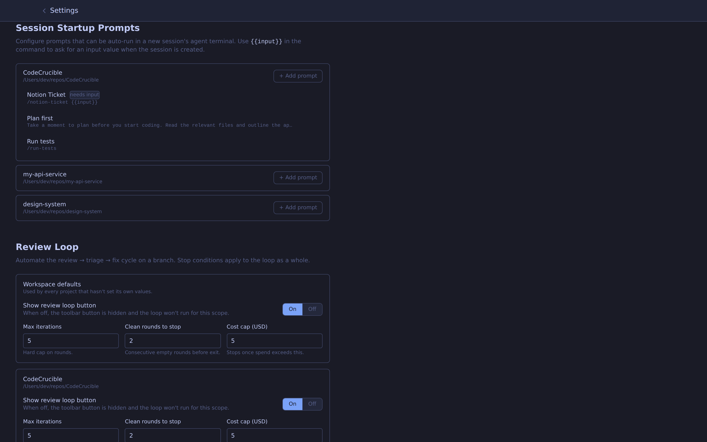
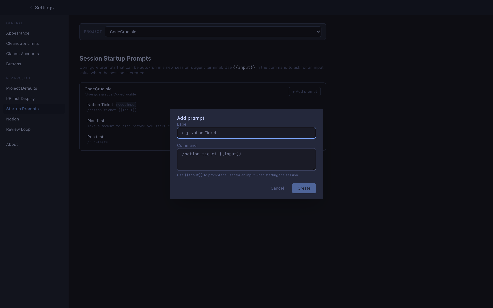

</details>

<details>
<summary><strong>Terminal management</strong></summary>

Sessions can open embedded terminals (xterm.js + node-pty) in the worktree directory. The Agent tab itself is a visual agent (see **Visual agents** below), not a terminal — except for cloud sessions, whose Agent tab is a terminal attached to the cloud session.

- **New Terminal** — Add shell terminals from the workspace tab bar's **+** menu
- **Claude terminals elsewhere** — Foreground Claude custom buttons and the interactive review loop still run Claude Code in a terminal you can watch and type into
- **Theme sync** — Terminal colors update when you change the app theme
- **Claude Code theme** — Separately configurable light/dark theme for the Claude Code CLI
- **Intervention detection** — Terminal output is scanned for permission prompts and questions, triggering notifications

</details>

<details>
<summary><strong>Visual agents</strong></summary>

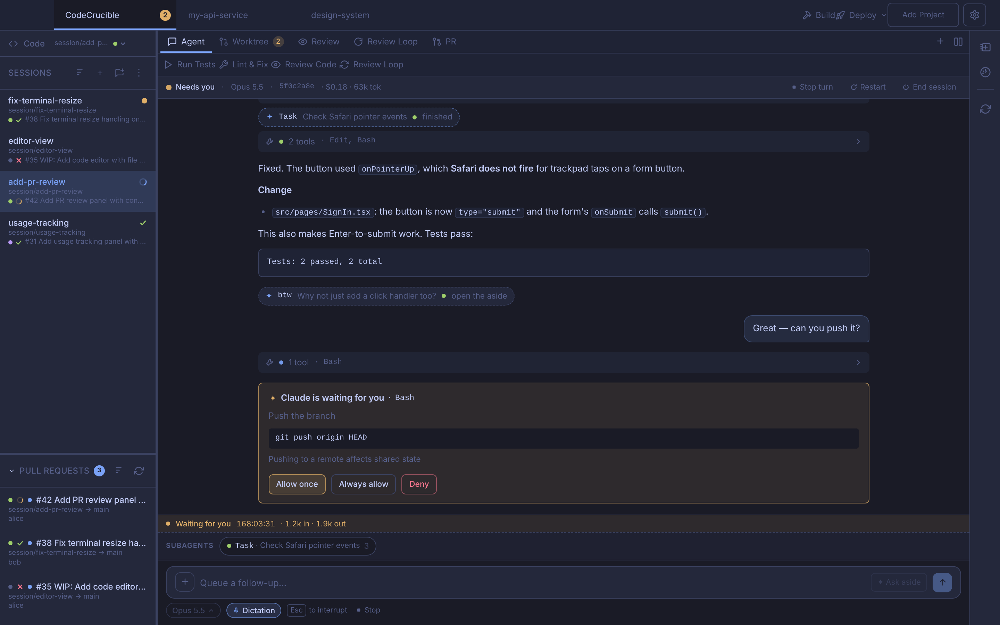

The agent interface: a chat UI for Claude Code, driven over `claude -p --input-format stream-json` instead of a terminal. There is no setting — every local session's **Agent** tab is a visual agent, and no Claude terminal is spawned for it. (A cloud session's Agent tab is a terminal attached to the cloud session instead; see **Cloud sessions & Teleport**.)

- **Opening one** — Each session's Agent tab starts one (a startup prompt becomes its first message). **New Agent** in the workspace tab bar's **+** menu opens another, labelled **Agent N**; **New Terminal** still opens a plain shell. Agent tabs from layouts saved before this change open as visual agents too
- **Code workspace** — **New Agent** in the Code (editor) view opens a visual agent in the repo root too. These aren't tied to a session, so they start a fresh conversation after an app restart
- **Background sessions** — Notion task pickups and scheduled sessions start the new session's visual agent with their prompt, and queued messages are sent to it, without opening the session
- **Model picker** — Choose Opus, Fable, Sonnet or Haiku below the composer (or with `/model`); switching mid-conversation keeps the conversation
- **Tool cards** — Each tool call is a card: edits render as syntax-highlighted diffs, Bash shows the command and its output, reads and searches collapse into a one-line summary you can expand
- **Permission and question cards** — When Claude needs approval (or asks a question with options) the card appears inline with Allow / Always allow / Deny, and the status bar switches to **Needs you**
- **Sub-agents** — Tasks Claude spawns appear in a tray above the composer; click one to open its full thread in a sheet that slides in from the right
- **`/btw` side questions** — Ask something without derailing the run: `/btw <question>` (or **Ask aside**) forks the conversation into a no-tools side session whose answer slides up over the composer. Nothing it says goes back into the main conversation
- **Slash menu** — Type `/` for commands: `/btw`, `/model`, `/clear` (fresh conversation), `/compact`, `/init`, `/review`, `/security-review`, `/cost` and more, fuzzy-matched as you type
- **Stop / interrupt** — `Esc` or **Stop turn** interrupts the current turn; **End session** stops the process; **Restart** brings it back on the same conversation
- **Resume** — Each visual agent's Claude session id and model are saved on the session, so after an app restart the tab picks up the same conversation (its transcript is replayed from disk)
- **Permissions** — Runs in your default (auto) permission mode: no `--permission-mode` or bypass flag is ever passed, and the worktree's hooks are written exactly as for terminal agents

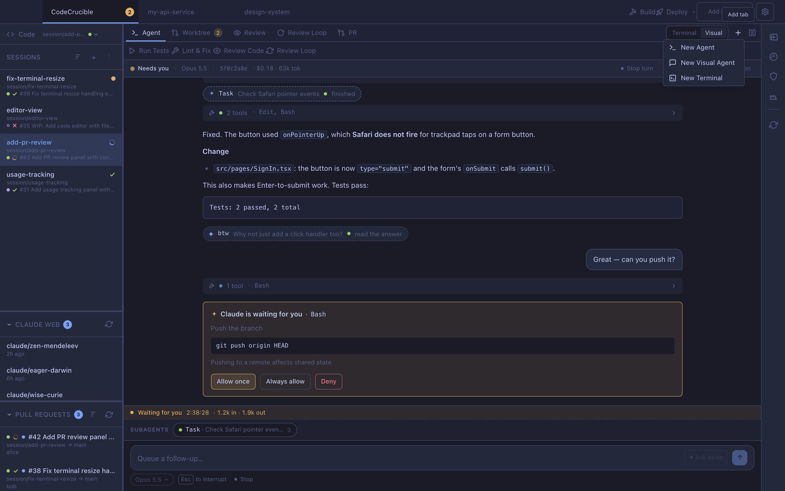

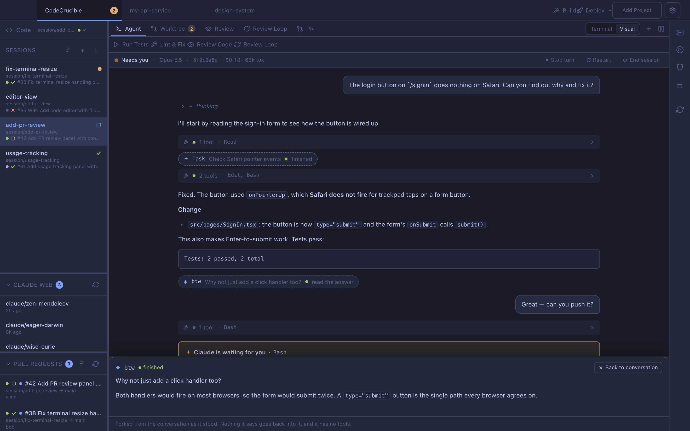

</details>

<details>
<summary><strong>Git integration</strong></summary>

Built-in git panel with commit history, changed files, and a GitHub-style diff viewer.

- **Commit log** — Scrollable list with polling for new commits
- **Changed files** — Both committed and working-tree changes, with right-click stage / unstage / stash / discard / reveal in Finder
- **GitHub-style diff viewer** — Three-zone rows (gutter / indicator / body) with tabular line numbers and progressive tinting so changes pop without overwhelming the surrounding context
- **Unified or side-by-side** — Toggle between the two modes per file; choice sticks across files
- **Full-file syntax context** — Syntax highlighting (Shiki) splices the visible hunk back into the whole-file blob before tokenising, so hunks that start mid-class or mid-string still highlight correctly
- **Click-anywhere context expansion** — The "Show N unchanged lines" strip is one big click target; the discrete ↑20 / ↓20 / ⇕all buttons override that default for fine-grained control. Works in both the worktree diff and PR diff.
- **Per-hunk collapse** — Click any `@@` row to fold a hunk; "Collapse hunks" toggle in the diff header collapses every hunk in the file
- **Commit status indicators** — Unpushed commits and new branches are marked
- **Push & PR** — Push button, open PR button, and merge controls with conflict detection
- **Working file diffs** — View uncommitted changes alongside commit diffs

<table>
<tr>
<td>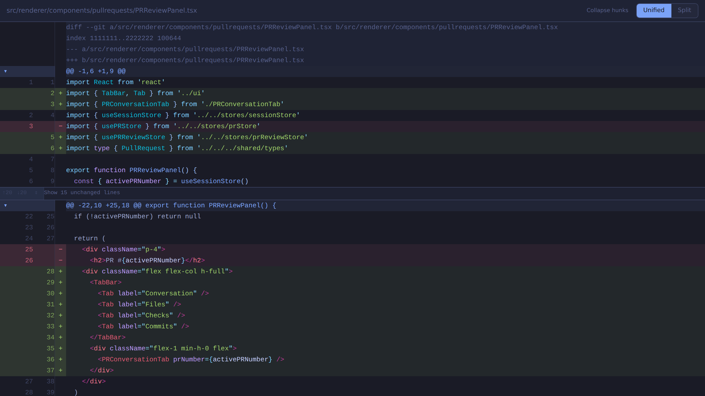</td>
<td>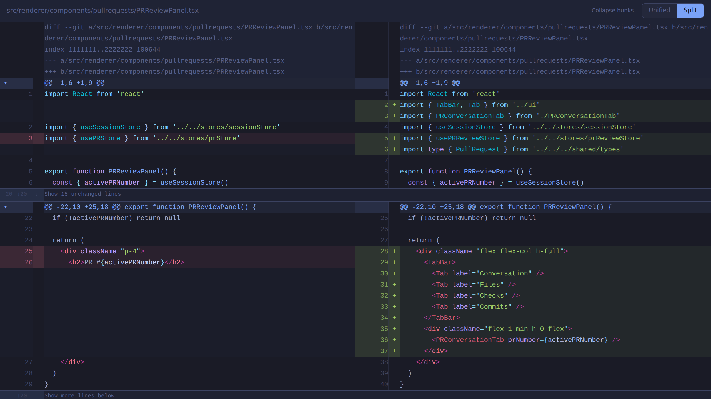</td>
</tr>
<tr>
<td>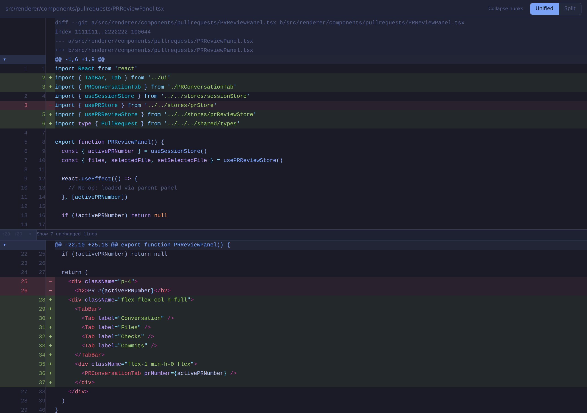</td>
<td>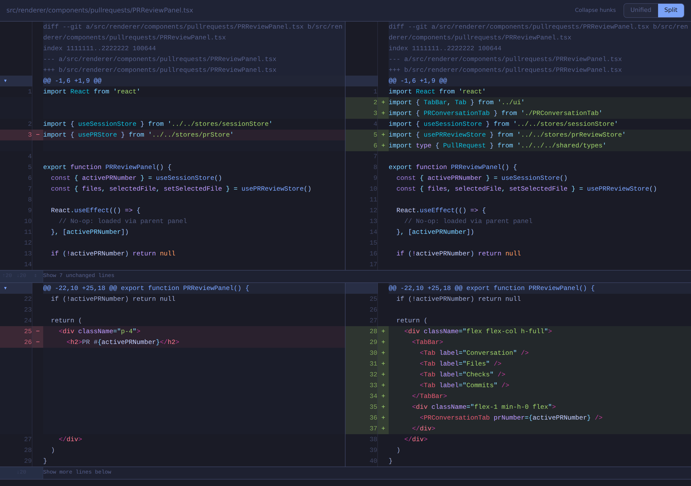</td>
</tr>
</table>

</details>

<details>
<summary><strong>PR review</strong></summary>

Full pull request review without leaving the IDE — comparable to GitHub's web UI for the day-to-day review loop.

- **Opens in its own worktree** — Clicking a PR creates a worktree at `<repo-parent>/.codecrucible-worktrees/<repo>/pr-<n>/` (via `gh pr checkout`, so forks work too) rather than swapping the main repo onto the PR branch. The main repo's branch is left alone. The worktree is reused if you click the same PR again, and torn down automatically once the PR is merged, closed, or disappears upstream
- **Conversation tab** — PR description, timeline, and CI checks with markdown rendering
- **Reviewers** — Approved / Changes requested / Awaiting review groupings, plus a typeahead "Request review" picker
- **Header summary** — At-a-glance "X approved · Y changes requested · Z pending" pill in the toolbar
- **Commits tab** — Per-commit diffs with prev/next navigation
- **File tree** — Changed files with viewed-file tracking and unresolved-comment badges
- **Scrollable diff view** — Lazy-loaded per file, optimised for very large PRs
- **Click-anywhere context expansion** — The "Show N unchanged lines" strip between hunks is one big click target (defaults to expand-all for a known gap, expand-down for a tail). The discrete ↑20 / ↓20 / ⇕all buttons inside the strip override that default for fine-grained control. Surrounding lines are pulled from the head SHA.
- **Per-hunk collapse** — Click any `@@` row to fold a hunk; "Collapse hunks" toggle in the diff header collapses every hunk in the file
- **Inline threads** — Reply to and resolve / unresolve review threads inline; resolved threads collapse to one line
- **Suggestion blocks** — `` ```suggestion `` blocks render as a side-by-side preview with an Apply button that writes to the worktree and creates a commit
- **Submit reviews** — Approve, request changes, or leave a comment
- **Merge** — Merge / squash / rebase with mergeability checks
- **Sidebar sort & filter** — Per-repo sort (PR number, recently updated, recently created) and filters (status, assignee, author, review-requested, CI status, unseen-only). "Me" pinned at the top of every person picker so the common case is one click
- **Sidebar display options** — Per-project control over which fields each PR card shows. Toggle the existing fields (state, CI, badges, branches, author) plus labels (with all/only-selected filter), requested reviewers, reviewer states, assignees, comments count, and updated time. An editable default applies to projects without overrides; per-project cards show a "Customized" pill and a Reset to default button

<table>
<tr>
<td>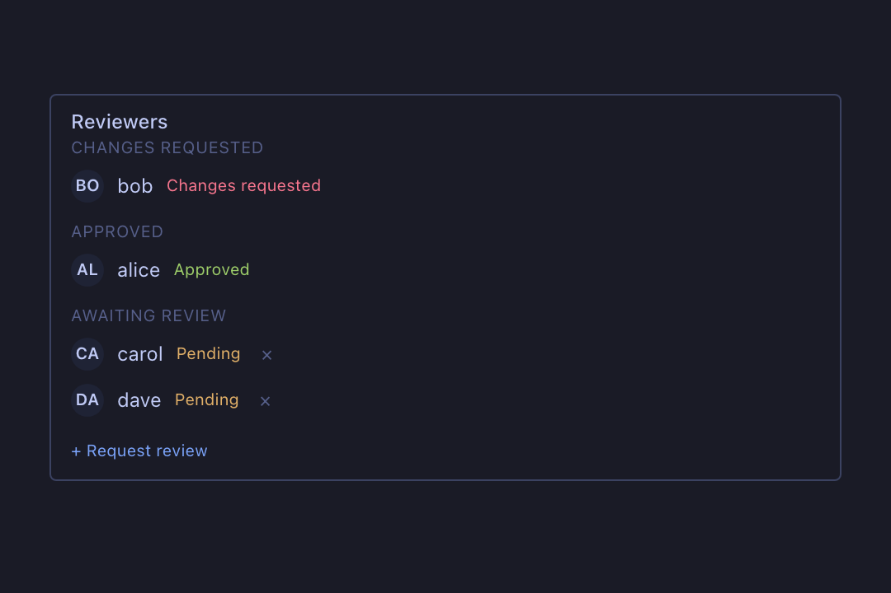</td>
<td>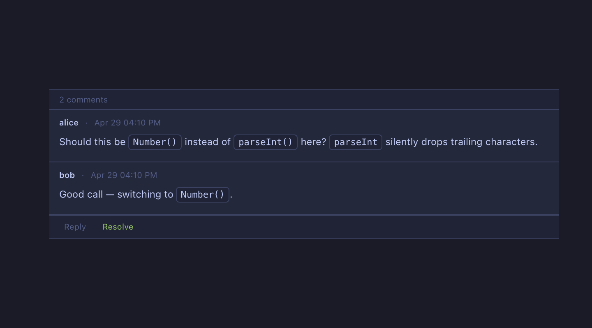</td>
</tr>
<tr>
<td>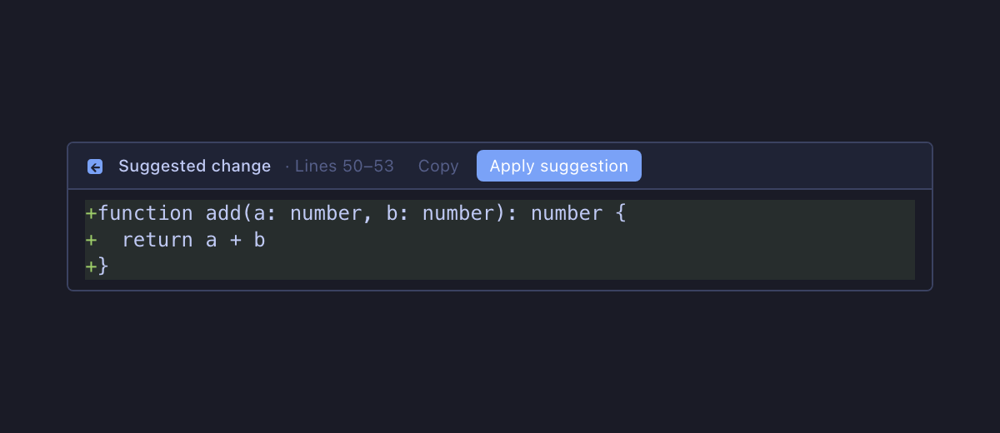</td>
<td>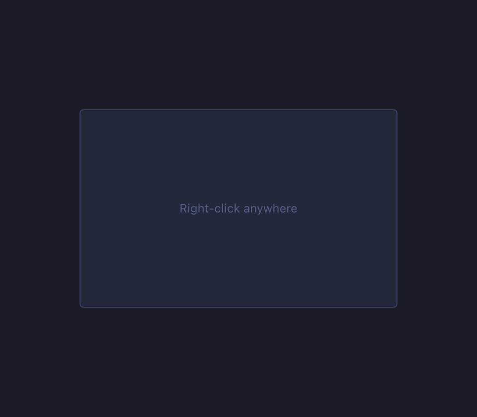</td>
</tr>
<tr>
<td>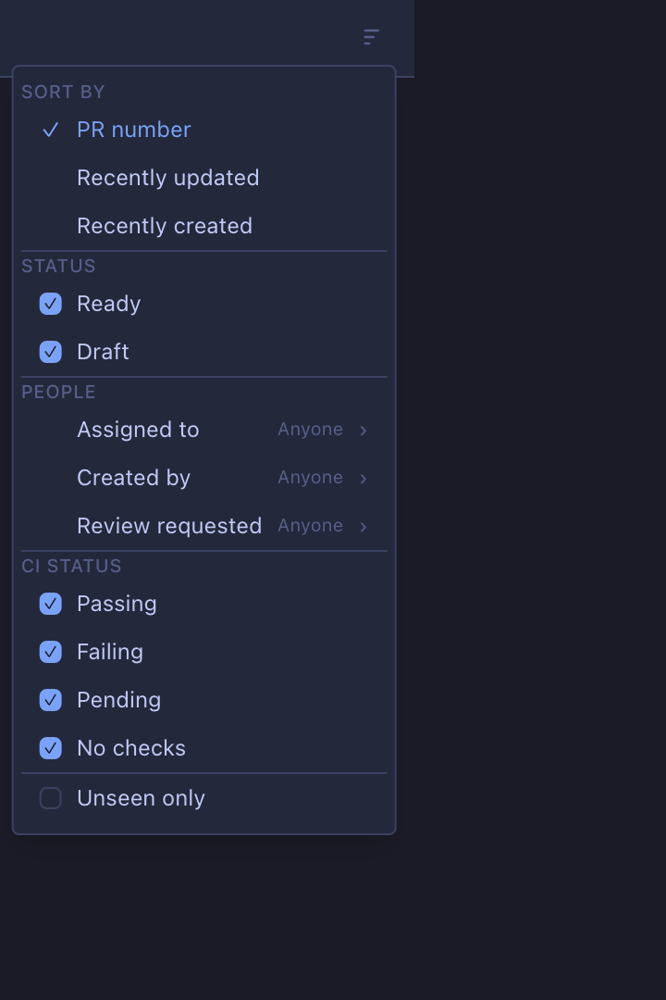</td>
<td>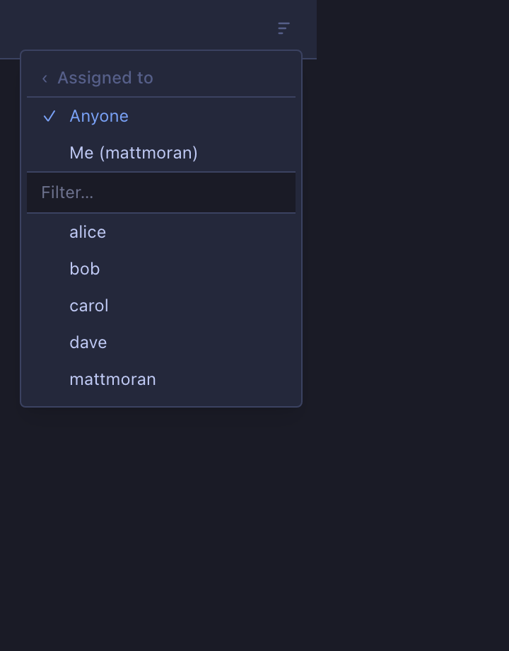</td>
</tr>
<tr>
<td>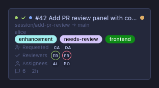</td>
<td>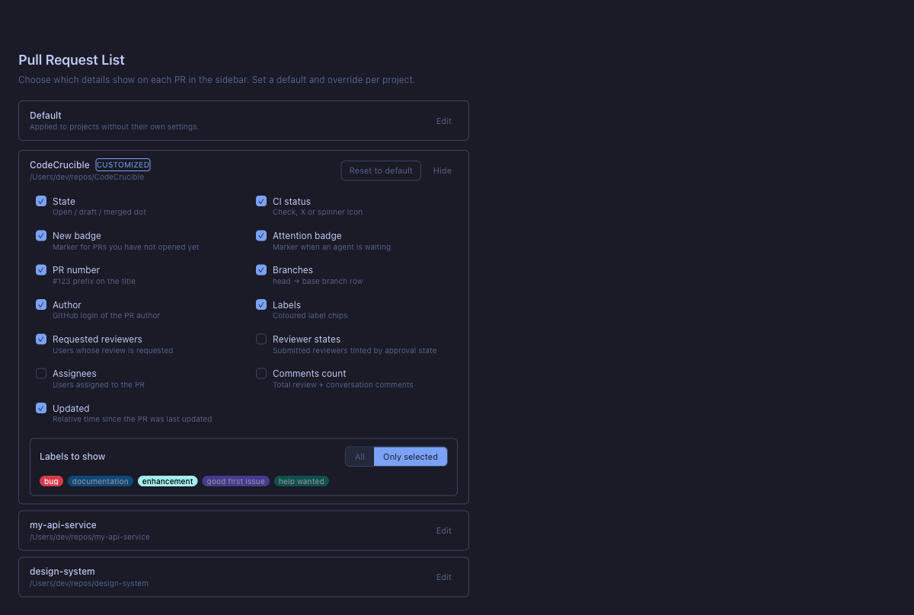</td>
</tr>
</table>

</details>

<details>
<summary><strong>Notion task integration</strong></summary>

Poll a Notion database for new tasks and auto-spawn a session per task. Sessions created this way carry a link back to the originating Notion page so you can jump straight to the ticket from the sidebar.

- **Auto-create sessions** — A poller watches your configured database every ~5 s; new rows matching your filters fire a session with the branch name, session name, and startup prompt resolved from page placeholders
- **OR filter groups** — Define multiple filter groups in the settings UI; a task is picked up if it matches *any* group (groups ORed; conditions within a group ANDed). Useful for "assigned to me in Project A *or* on the urgent list in Project B"
- **Ticket link under branch name** — The session card shows a small ticket icon and the page title beneath the branch. Clicking it hands off to your OS so it opens in the Notion desktop app (if installed) or your default browser — never inside Electron

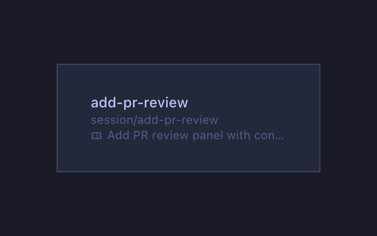

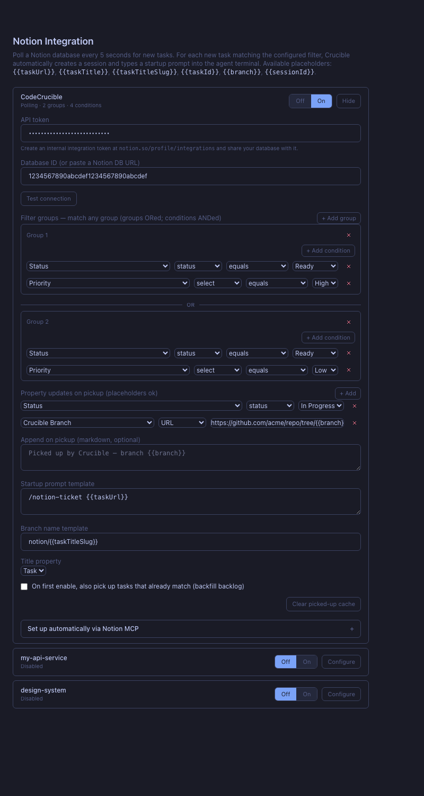

</details>

<details>
<summary><strong>Notifications & intervention detection</strong></summary>

Detects when Claude Code needs user input: visual agents report it from their run state (a permission or question card is waiting), and Claude terminals by scanning their output for permission prompts and questions.

- **Desktop notifications** — OS-level notifications when Claude needs attention
- **Dock badge** — macOS dock badge shows count of sessions needing input
- **Session status indicators** — Sidebar icons show running (spinner), attention (yellow dot), completed (green check)
- **Auto-clear** — Attention state clears when you navigate to the session
- **Cross-project** — Notification badges appear on project tabs for non-active projects too

</details>

<details>
<summary><strong>Usage tracking</strong></summary>

Monitor Claude Code usage and rate limits from the right panel.

- **Rate limit bars** — 5-hour and 7-day usage windows with visual progress bars
- **Session stats** — Cost, duration, lines added/removed per session
- **Activity chart** — Daily activity over the past week (messages, sessions, tool calls)
- **Subscription info** — Shows your current plan and rate limit tier
- **Auto-continue on limit** — When a session or agent actually hits its usage limit, a popup offers to queue a follow-up prompt that fires automatically once the window resets. The trigger watches terminal output for Claude's real "usage limit reached" banner (so for now it covers Claude terminals, not visual agents) — the message that genuinely blocks a conversation — not a usage percentage, so accounts with no hard limit (overage/extra usage) never mis-fire. Opt into Settings → Usage Limits to skip the popup and auto-queue `continue` for you

</details>

<details>
<summary><strong>Code editor</strong></summary>

Built-in code editor for when you need to make quick edits without switching apps.

- **CodeMirror 6** — Language support for JavaScript, TypeScript, Python, CSS, HTML, JSON, and Markdown
- **Code folding** — Fold-gutter chevrons let you collapse functions, classes, and any other foldable region; `Cmd-Alt-[` / `Cmd-Alt-]` keymap supported
- **File explorer** — Directory tree for any worktree, with file watching for external changes
- **Right-click context menu** — Open, copy relative/absolute path, reveal in Finder, delete file
- **Create and rename** — Create new files, rename existing ones from the explorer
- **Toggle mode** — Switch between editor view and terminal view from the workspace
- **Branch picker** — Click the branch label next to **Code** in the sidebar to search and switch branches. Branches with open PRs show a `#N` badge and a status dot (open / draft / merged). Switching with uncommitted changes prompts to either stash them or carry them onto the new branch.
- **Worktree tab** — The same commit log + working changes + diff viewer the session worktrees get, but pointed at the main repo so you can dig through history and uncommitted changes for whichever branch you have checked out.

<table>
<tr>
<td>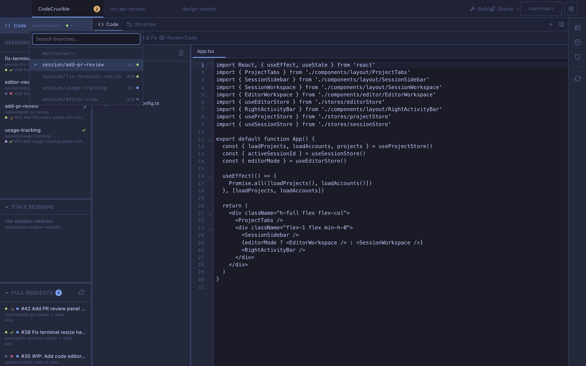</td>
<td>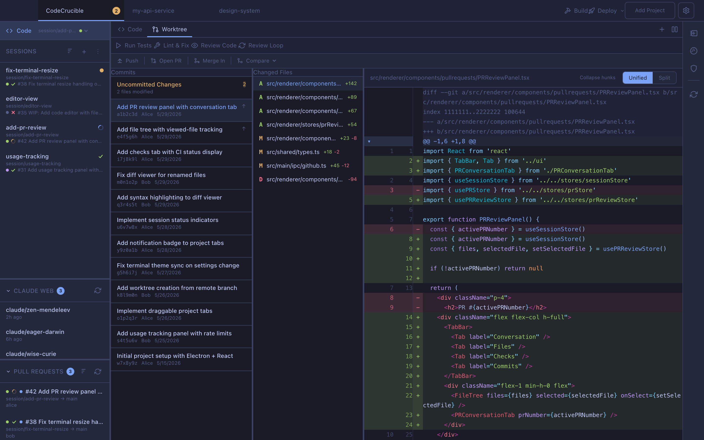</td>
</tr>
</table>

</details>

<details>
<summary><strong>Notes</strong></summary>

Per-project notes panel accessible from the right activity bar.

- Create, edit, and delete markdown notes
- Useful for tracking session goals, review checklists, or project context

</details>

<details>
<summary><strong>Custom buttons</strong></summary>

Create configurable action buttons that run shell commands or Claude prompts from anywhere in the IDE.

- **Three placements** — Session toolbar, top project bar, or right activity bar
- **Two action types** — Shell commands or Claude prompts with template variable substitution (`{{branch}}`, `{{worktreePath}}`, `{{sessionName}}`, `{{repoPath}}`, `{{projectName}}`)
- **Two execution modes** — Background (silent with toast notification on completion) or terminal (interactive with live output)
- **Button groups** — Organize related buttons into dropdown menus
- **Scope control** — Global, all projects, or specific projects only
- **Keyboard shortcuts** — Assign Electron accelerator shortcuts (e.g. `Cmd+Shift+T`)
- **Confirmation dialogs** — Optional confirmation prompt before executing destructive actions
- **Icon picker** — 35+ built-in Lucide icons plus custom emoji support

</details>

<details>
<summary><strong>Review loop</strong></summary>

Automate the review → triage → fix cycle on a branch. There are three variants, chosen per project in **Settings → Review Loop** — **Lite**, **Pro**, and **Efficient**.

**Lite and Pro** run each round as three phases — Review, Triage, Implementation — in one of two run modes:

- **Headless (`-p`, the default)** — each phase runs as a background `claude -p` process with **no pseudo-terminal**, and the panel streams its transcript read-only. Because it uses no PTY, you can run many loops at once without hitting the macOS pseudo-terminal limit. It runs in your normal auto permission mode — never `--dangerously-skip-permissions` and never `--permission-mode acceptEdits`.
- **Interactive** — each phase opens a live Claude Code terminal side by side that you can watch and type into in real time, so you can step in and steer it whenever you want.

1. **Review** — A Claude terminal reviews the diff vs. base. In the Pro variant it writes structured findings to `.crucible/review-loop/round-N-issues.json`; in Lite it runs `/review` on the PR.
2. **Triage** — A second Claude terminal reads those findings and fans out a sub-agent per issue. Each sub-agent decides `fix` / `skip` / `defer` / `noop` and writes a short justification.
3. **Implementation** — A third Claude terminal applies the fixes, commits, and pushes.

In interactive mode each phase advances when its turn finishes (detected via Claude's `Stop` hook), then **freezes with a read-only "Completed" overlay** so its output stays readable but can't be edited; in headless mode the phase ends when the `claude -p` process exits. Either way the next phase starts in a fresh column, and every round opens a new row of three columns — so the whole history of a loop stays on screen.

**Efficient** is a token-frugal variant with a fixed two-panel topology. A *fresh* review genuinely benefits from clear, unbiased context every round, but triage and implementation don't — so it spends fresh context only where it matters:

- **Left** — a fresh, headless `claude -p` **review** per round, stacked newest-first. Clear context every round keeps each review honest.
- **Right** — **one long-lived, interactive worker** terminal that triages then implements for *every* round, keeping its conversation across the whole loop. Because it remembers earlier rounds, it won't re-litigate issues it already deliberately skipped or deferred. Round 1's review is handed to it at spawn; later rounds' reviews are pasted into the live session, and each turn advances on the worker's `Stop` hook.

This trades three fresh sessions per round (Lite/Pro) for one fresh review plus a persistent worker — much cheaper over a multi-round loop, with better continuity. The run-mode toggle doesn't apply (the topology is fixed); convergence is the same as Lite (a round with no new commit is "clean").

The loop stops on the first of: N consecutive clean rounds (default 2), iteration cap (default 5), or manual cancel. Phase terminals are swept when a loop finishes, when a new loop starts for the session, and when the session is closed, so PTYs never accumulate toward the macOS limit. Workspace defaults and per-project overrides live in **Settings → Review Loop**, including the headless/interactive run-mode toggle and a per-project toggle that hides the toolbar button and prevents the loop from running for that scope.

Skipped or deferred items get summarised in a single sticky comment on the open PR (using a hidden marker so subsequent rounds update the same comment instead of re-posting). That gives reviewers a record of what was knowingly left undone and why.

The Review Loop tab in the session workspace shows live progress: an overall status pill and current phase. In Lite/Pro that's three columns per round with their own status pills (each either a live terminal or a streamed headless transcript), per-round triage decisions, and a per-round log. In Efficient it's the two-panel layout instead — the stack of fresh reviews on the left and the single persistent worker terminal on the right.

<table>
<tr>
<td>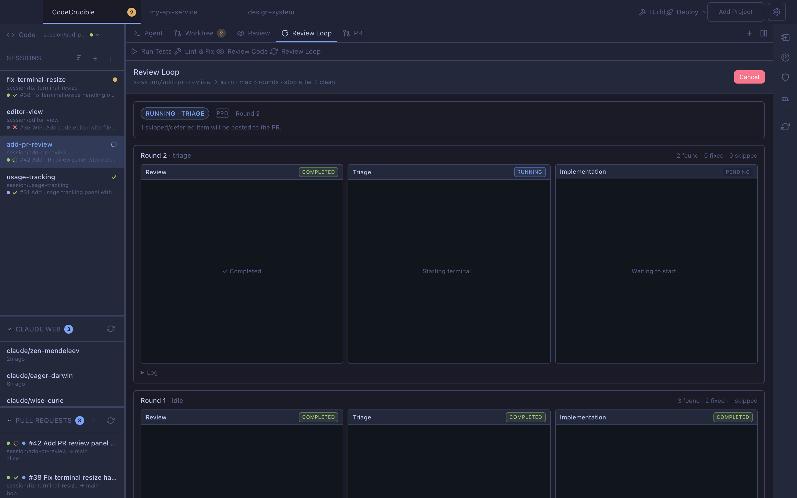</td>
<td>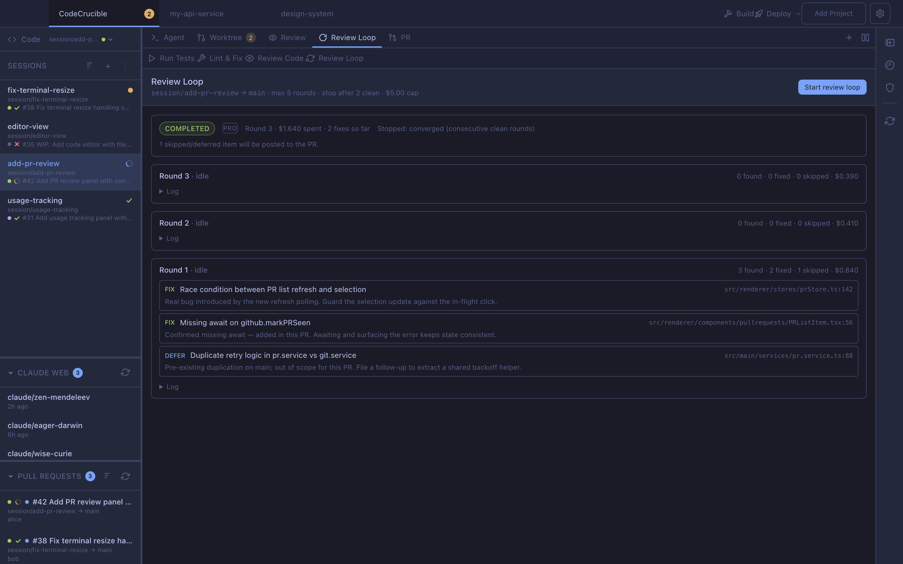</td>
</tr>
<tr>
<td>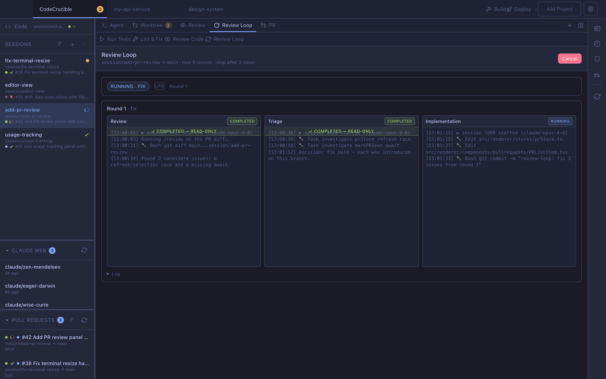</td>
<td>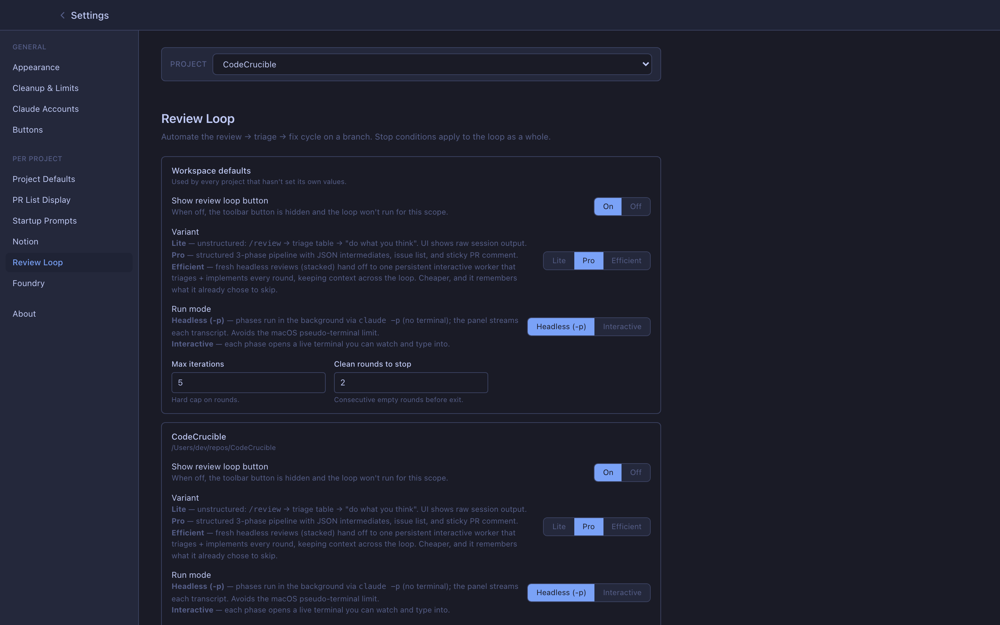</td>
</tr>
<tr>
<td colspan="2">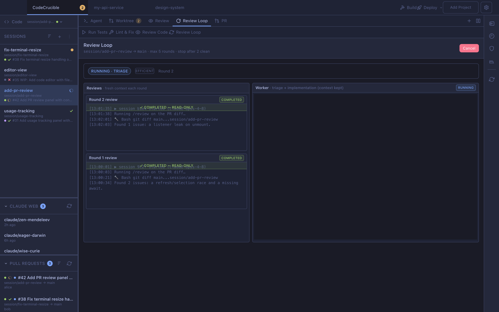</td>
</tr>
</table>

</details>

<details>
<summary><strong>Architecture</strong></summary>

Three-layer Electron architecture with strict process isolation:

```
src/
├── main/            # Electron main process (Node.js)
│   ├── ipc/         # IPC handlers (one file per domain)
│   └── services/    # Business logic (git, worktree, terminal, notification)
├── preload/         # contextBridge — typed API on window.api
├── renderer/        # React UI (no Node.js access)
│   ├── components/
│   │   ├── ui/           # Base components (Button, Dialog, ListBox, TabBar, etc.)
│   │   ├── layout/       # App shell (ProjectTabs, SessionSidebar, SessionWorkspace)
│   │   ├── sessions/     # Session management (SessionCard, CreateSessionDialog)
│   │   ├── git/          # Git viewer (CommitList, ChangedFiles, DiffViewer)
│   │   ├── terminal/     # Terminals (DynamicTerminalPanel, ReviewTerminalPanel)
│   │   ├── editor/       # Code editor (CodeEditorPanel, FileExplorer)
│   │   ├── buttons/      # Custom buttons (CustomButtonBar, ButtonRenderer, IconPicker)
│   │   ├── pullrequests/ # PR review (PRReviewPanel, PRConversationTab, FileTree)
│   │   ├── notes/        # Notes panel
│   │   └── usage/        # Usage tracking panel
│   ├── stores/      # Zustand state (14 stores)
│   ├── hooks/       # Shared hooks (useResizable, useFocusTrap, useRovingIndex)
│   └── styles/      # Tailwind + CSS custom property themes
└── shared/          # Types, constants, patterns shared across processes
```

### Tech stack

- **Runtime**: Electron 33 (main + renderer)
- **UI**: React 19, TypeScript, Tailwind CSS 4
- **Build**: electron-vite 5, Vite 8
- **State**: Zustand (14 stores)
- **Terminal**: xterm.js + node-pty
- **Git**: simple-git
- **Syntax highlighting**: Shiki
- **Code editor**: CodeMirror 6
- **Markdown**: marked

### IPC

All communication between renderer and main process goes through typed IPC channels defined in `src/shared/constants.ts`. The renderer has no Node.js access — it communicates exclusively via `window.api`, exposed by the preload script with `contextIsolation: true`.

### Stays awake while running

So long-running work — terminals, Claude sessions, review loops and the remote relay — keeps running when you lock the screen and walk away, the app prevents the Mac from sleeping for its entire lifetime. It holds an Electron `powerSaveBlocker` of type `prevent-app-suspension` (started on launch, released on quit, re-armed after a forced sleep/resume), so the *system* stays awake while the *display* is still free to turn off when the screen locks. See `src/main/services/keep-awake.service.ts`. No setting — it's always on while the app is open.

</details>

<details>
<summary><strong>Theming</strong></summary>

Four built-in themes: **Dark** (Tokyo Night, default), **Light**, **Soft Light**, and **Ultra Dark**.

Themes are defined as CSS custom properties in `src/renderer/styles/globals.css`. Tailwind utilities reference these properties via the `@theme` block, so switching themes is instant and all components respond automatically.

Terminal colors sync with the app theme. The Claude Code CLI theme (light/dark) can be configured separately in settings.

To add a custom theme, add a `[data-theme="your-theme"]` block with the same property names:

```css
[data-theme="your-theme"] {
  --color-bg: #...;
  --color-text: #...;
  --color-accent: #...;
  /* see globals.css for the full list */
}
```

</details>

<details>
<summary><strong>Keyboard shortcuts</strong></summary>

| Key | Action |
|-----|--------|
| Arrow Up/Down | Navigate lists (sessions, commits, files) |
| Arrow Left/Right | Navigate tabs |
| Enter / Space | Activate selection |
| Escape | Close dialogs, settings, panels |
| Tab | Standard focus navigation |

All interactive elements use `focus-visible` rings — visible on keyboard navigation, hidden on mouse clicks.

</details>

## Contributing

See [CONTRIBUTING.md](CONTRIBUTING.md). The short version: PR descriptions should explain the **intent and prompt** behind the change, not just the code. Features are accepted based on whether the aim fits the project.

## License

[MIT](LICENSE) — do whatever you want with it.
